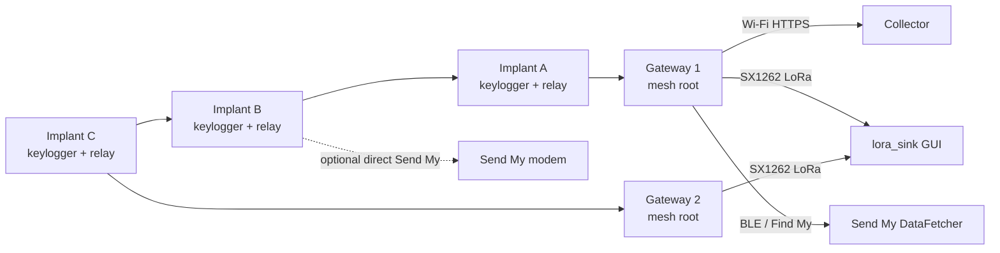

# DuckLogger MeshOps — Requirements and Technical Design

> Status: approved design, implemented as the current prototype contract.
> Hardware-only behavior and the external Send My firmware/DataFetcher remain
> deployment dependencies rather than code vendored into this repository.
>
> Research prototype for authorized engagements and isolated lab testing. Use only
> on equipment and networks for which you have explicit written authorization.

## 1. Purpose

Redesign DuckLogger MeshOps as an active-keylogger mesh:

- Every implant captures keystrokes locally and is a mesh node.
- Implants send captured key events through the mesh toward one or more configured gateways.
- Implants relay traffic for other implants that cannot reach a gateway directly.
- Each gateway can exfiltrate events by Wi-Fi, LoRa, or the Send My / Apple Find My
  channel (`positive-security/send-my`).
- Network setup chooses, per implant, whether it uses mesh, Send My, or both.
- A single installer defines the whole network and flashes implants and gateways.
- When LoRa egress is used, a `lora_sink` provides a graphical console for keylogger
  content and network state.

### User requirement mapping

| Requested capability | Design section |
| --- | --- |
| Every implant is an active keylogger | FR-1, §9, §17 |
| Every implant is a mesh node delivering to one or more gateways | FR-2, FR-3, §9.5 |
| An implant can relay another implant's data | FR-3, §9.5 |
| Gateway egress by Wi-Fi, LoRa, or Send My | FR-5, §11 |
| Per-implant choice of mesh and/or direct Send My | FR-4, §10.5 |
| `installer.sh` defines and flashes the whole network | FR-6, §13 |
| `lora_sink` GUI for keylogger content and network state | FR-7, §12 |

## 2. Goals and non-goals

### Goals

- Preserve the current DuckLogger keylogging and local logging behavior.
- Support multi-hop ESP-NOW delivery to one or more gateways.
- Support per-device uplink policy without mixing conflicting Send My paths.
- Make whole-network provisioning repeatable and auditable from one installer.
- Expose all authorized keylogger content and network health in the LoRa receiver UI.
- Keep runtime code MicroPython-compatible and hardware-free testable.

### Non-goals

- Production-grade transport, OTA updates, or unattended long-term deployment.
- Arbitrary file transport, remote HID injection, or raw HID frame transport.
- Bypassing authorization, Apple Find My terms, or radio duty-cycle rules.
- Using Send My as an authenticated or confidential channel.
- A cloud backend; all analysis remains local.

## 3. Roles and glossary

| Term | Meaning |
| --- | --- |
| Implant | ESP32-S3 DuckLogger keylogger and ESP-NOW mesh node. Captures decoded key events. |
| Gateway | Mesh root that stores events and executes configured egress functions. |
| Relay | Any implant that forwards another implant's packets toward a gateway. |
| `lora_sink` | External SX1262 receiver with authenticated local web console. |
| Send My | BLE/Apple Find My upload path implemented by `positive-security/send-my`. |
| Network plan | Declarative description of every device, role, address, and uplink policy. |
| Event | Authorized telemetry record; `key_event` is the keylogger payload. |
| Boot ID | Random identifier regenerated on each boot; disambiguates sequence numbers. |

## 4. Functional requirements

### FR-1 — Active keylogging

- FR-1.1 Each implant captures decoded DuckLogger key presses locally.
- FR-1.2 Key events carry a decoded press string of at most 120 characters.
- FR-1.3 Raw HID frames, files, and arbitrary payloads are never accepted by the mesh.
- FR-1.4 Local key logging continues when no mesh route or external uplink is available.

### FR-2 — Mesh membership

- FR-2.1 Every implant is an ESP-NOW mesh node with a unique `implant_id` and MAC.
- FR-2.2 All mesh devices share `network_id`, radio channel, and peer key.
- FR-2.3 The network plan defines one or more gateways.
- FR-2.4 Only allowlisted MACs may inject, relay, or receive mesh traffic.
- FR-2.5 An implant can originate, relay, or both; relay capability is configurable.

### FR-3 — Multi-hop delivery and relay

- FR-3.1 An implant sends its own events toward a configured gateway.
- FR-3.2 An implant relays events received from other implants when it has a valid route.
- FR-3.3 Relays decrement TTL and reject expired, duplicate, or looped packets.
- FR-3.4 Gateways acknowledge delivered events; sources retry within configured limits.
- FR-3.5 Routes expire and are replaced from fresh gateway advertisements.
- FR-3.6 Delivery policy supports at least `best`, `primary`, and `all` gateway modes.

### FR-4 — Per-implant uplink policy

- FR-4.1 Each implant independently enables or disables `uplink.mesh`.
- FR-4.2 Each implant independently enables or disables `uplink.sendmy`.
- FR-4.3 At least one uplink must be enabled for an implant.
- FR-4.4 Enabling both sends the same event through both paths; downstream consumers
  deduplicate by event identity.
- FR-4.5 Relay service is independent of the implant's own uplink choice.

### FR-5 — Gateway egress

- FR-5.1 Gateway egress supports `wifi`, `lora`, and `sendmy`.
- FR-5.2 Each gateway selects its active egress in the network plan.
- FR-5.2a Every gateway keeps egress active; `log` is the local-only fallback.
- FR-5.3 `wifi` uses an infrastructure STA connection and an HTTPS collector.
- FR-5.4 `lora` uses the native SX1262 link to one `lora_sink`.
- FR-5.5 `sendmy` uses a Send My modem and is retrieved through the Send My DataFetcher.
- FR-5.6 If any implant has `uplink.sendmy` enabled, every gateway must have
  `egress.sendmy` disabled. The installer and runtime validation enforce this rule.
- FR-5.7 Failed egress records remain queued in a bounded, persistent spool.
- FR-5.8 Egress backends are independent; cross-backend delivery is not transactional.

### FR-6 — Whole-network installer

- FR-6.1 `installer.sh` accepts a network plan and/or an interactive wizard.
- FR-6.2 It inventories exact serial ports, MACs, roles, and device IDs before flashing.
- FR-6.3 It validates the complete plan before changing any board.
- FR-6.4 It renders one `settings.json` per device into an ignored local directory.
- FR-6.5 It flashes implants, gateways, `lora_sink`, and Send My modems as assigned.
- FR-6.6 It requires explicit `FLASH` confirmation and never selects a port implicitly.
- FR-6.7 It supports a non-flashing inventory mode and a dry-run plan validation mode.
- FR-6.8 It records a post-flash inventory and verification report.

### FR-7 — LoRa sink console

- FR-7.1 `lora_sink` receives, authenticates, reassembles, and deduplicates LoRa batches.
- FR-7.1a `lora_sink` is an egress destination and never owns an egress configuration.
- FR-7.2 It displays live key events and reconstructed text per implant and session.
- FR-7.3 It derives direct versus relay paths from hop metadata.
- FR-7.4 It shows gateway identity, last-seen time, event counters, RSSI/SNR, and queue health.
- FR-7.5 It filters by gateway, implant, session, event kind, and time.
- FR-7.6 It exports bounded NDJSON and supports authenticated log deletion.
- FR-7.7 All console endpoints require authentication; the console is local-lab only.

## 5. Non-functional requirements

### NFR-1 — Compatibility

- Runtime remains MicroPython-compatible on ESP32-S3.
- No new mandatory third-party packages; optional modules are guarded.
- Pure protocol, settings, routing, storage, and egress logic must run under CPython tests.

### NFR-2 — Reliability

- Delivery is at-least-once with bounded retries and deduplication at gateways and sinks.
- Queues are bounded; when full, the oldest event is dropped and counted.
- Spools survive reboot without corrupting the boot path.
- Route failover occurs after consecutive delivery failures.

### NFR-3 — Security and privacy

- ESP-NOW peers use encrypted links with a shared 16-byte peer key.
- LoRa frames use HMAC-SHA256 authentication with a shared key.
- Wi-Fi egress uses TLS and validates collector responses (2xx).
- Management and console APIs require a token; no default credentials.
- Send My is public, unauthenticated, and unencrypted. It must not carry secrets.
- `mesh.peer_macs` is a filtering allowlist, not a cryptographic identity.
- The design must document that replay protection and per-device mesh keys are gaps.

### NFR-4 — Performance

- Mesh delivery should complete within seconds for 1–4 hops on a quiet channel.
- Send My is low-throughput and high-latency; it is not suitable for continuous streams.
- The `lora_sink` UI must remain responsive with bounded in-memory event windows.
- Storage retention is bounded by bytes and file count.

### NFR-5 — Operability

- All device configuration is rendered from one network plan.
- Status is observable from gateways and `lora_sink`.
- Failures are visible as counters, not silent drops.
- Secrets live only in ignored local files and on devices.

## 6. Constraints and assumptions

- ESP-NOW is the only mesh radio; LoRa remains gateway egress, not mesh transport.
- The canonical LoRa hardware is the Seeed 113110064 XIAO ESP32S3 + Wio-SX1262 B2B kit.
- Send My is a BLE/Apple Find My path, not an HTTPS API. It requires compatible ESP32
  firmware and a macOS retrieval host.
- Send My firmware is a proof of concept with no encryption or authentication and is
  AGPL-3.0 licensed. Modification or redistribution has license obligations.
- Using Apple Find My may be subject to Apple terms and local law; authorized lab only.
- The prototype supports `best`, `primary`, and `all` multi-gateway delivery policies.
- Device clocks are not synchronized; timestamps are gateway-relative unless time sync
  is added later.
- Hardware-only behavior must be verified on boards; CI covers only CPython logic.

## 7. Topology and data flows



### Data paths

1. **Implant to gateway (mesh):** key event -> local queue -> selected parent -> relay(s)
   -> gateway -> local NDJSON -> egress.
2. **Implant direct Send My:** key event -> local Send My queue -> modem -> BLE
   advertisement -> Apple Find My -> DataFetcher.
3. **Gateway Wi-Fi:** gateway -> HTTPS collector.
4. **Gateway LoRa:** gateway -> fragmented authenticated frames -> `lora_sink` -> UI.
5. **Gateway Send My:** gateway -> Send My modem -> Find My -> DataFetcher.

## 8. Configuration design

### 8.1 Network plan (installer input)

The installer-level plan describes the whole network. It is the source of truth for
rendering device settings. A JSON plan is preferred because it can be validated with
the Python standard library already available on the provisioning host.

Conceptual fields:

```json
{
  "network": {
    "id": "lab-mesh-01",
    "channel": 6,
    "peer_key": "<16 bytes>",
    "protocol_version": 4
  },
  "gateways": [
    {
      "id": "gateway-01",
      "mac": "CHANGE_ME_GATEWAY_MAC",
      "egress": ["lora"],
      "management": {"enabled": true, "mode": "ap"}
    }
  ],
  "implants": [
    {
      "id": "implant-a",
      "mac": "CHANGE_ME_IMPLANT_MAC",
      "uplink": {"mesh": true, "sendmy": false},
      "relay": true
    }
  ],
  "lora_sink": {"id": "sink-01", "mac": "CHANGE_ME_SINK_MAC"},
  "sendmy": {
    "enabled": false,
    "modem_id": "42424242",
    "placement": "companion",
    "max_message_bytes": 180,
    "batch_interval_ms": 60000,
    "batch_size": 32
  }
}
```

### 8.2 Per-device settings

Each board receives a nested `settings.json` derived from the plan:

- `device`: role, `id`, `mesh_only`, keylogger/data-source flags, relay flag.
- `mesh`: `network_id`, `channel`, `peer_key`, `peer_macs`, transport, route timers,
  retry limits, queue limits, outbox persistence.
- `delivery`: gateway list and mode (`best`, `primary`, `all`).
- `uplink`: per-implant `mesh` and `sendmy` booleans.
- `egress`: gateway backend selection plus backend-specific settings.
- `sendmy`: modem UART, modem ID, queue limits, message format version,
  `batch_interval_ms`, `batch_size`.
- `management`: AP/STA mode, credentials, API token.
- `lora`: SX1262 pins, frequency, modulation, key, retry policy.
- `storage`: paths, rotation, retention.
- `keylog`: local log size and flush interval.

The tracked `settings.example.json` documents the legacy flat standalone
schema. Operators copy it to the ignored local `settings.json` before use.

### 8.3 Validation rules

The plan and every rendered settings file must reject:

- duplicate device IDs or MACs;
- missing network ID, channel, peer key, or peer allowlist;
- a peer key that is not exactly 16 bytes;
- placeholder secrets (`CHANGE_ME_*`, short password/token);
- mesh roles without `mesh_only: true` unless explicitly allowed;
- `data_source` outside a node role or without mesh enabled;
- an implant with both uplinks disabled;
- a gateway with no egress backend;
- Send My enabled on any implant while any gateway uses Send My egress;
- LoRa settings that differ between gateway and `lora_sink`;
- unsupported transport names or protocol versions;
- more than one gateway with the same ID;
- a gateway list that references an unknown gateway.

## 9. Protocol and event design

### 9.1 Authorized event kinds

Keep the allowlist:

- `heartbeat`
- `synthetic_counter`
- `link_test`
- `key_event` (decoded press string, at most 120 characters)

No other kind is accepted at an implant, relay, gateway, or sink.

### 9.2 Event identity

Every event has a stable identity:

`(network_id, implant_id, boot_id, sequence)`

This identity is used by mesh deduplication, gateway storage, LoRa sink deduplication,
Wi-Fi collector idempotency, and Send My retrieval deduplication.

### 9.3 Event record

A `key_event` record contains:

- `network_id`, `implant_id`, `boot_id`, `sequence`;
- `session_id` (keylogging session);
- `kind` and payload (`keys`, `mods`, `text` for `key_event`);
- source monotonic timestamp;
- `hop_count` and path metadata where available;
- `gateway_id` and gateway receive time after storage.

### 9.4 Mesh packet types

- Route advertisement: `v`, `n`, `t: "r"`, `gateway_id`, `hops`, `epoch`, `load`.
- Data: `v`, `n`, `t: "d"`, source, boot ID, sequence, kind, payload, TTL, hop count,
  optional target gateway.
- Acknowledgement: `v`, `n`, `t: "a"`, source, boot ID, sequence, gateway ID.

Packets remain compact and bounded to 240 bytes. A protocol version bump is required
for new fields, multi-gateway semantics, or authentication changes.

### 9.5 Multi-gateway routing

- Each gateway advertises itself as a root with hop count zero and an epoch.
- Each node maintains a candidate table keyed by gateway ID.
- A candidate contains parent, hop count, expiry, failure count, and last load hint.
- Delivery modes:
  - `best`: lowest hop count, then lowest load, then stable tie-break.
  - `primary`: ordered gateway preference; fail over only after delivery failure.
  - `all`: send to every reachable configured gateway; downstream deduplicates.
- Relays forward toward the packet's target gateway when present; otherwise toward the
  best reachable gateway.
- Gateways never relay gateway-originated traffic; they only receive, deduplicate, and
  store.
- Loop prevention uses TTL, source/sequence deduplication, and a hop limit.
- Per-gateway failure counters trigger temporary parent hold-out and re-selection.

### 9.6 Delivery semantics

- Mesh delivery is at-least-once.
- Gateways ACK each accepted event; duplicates are re-ACKed but not stored twice.
- Sources retry the same event identity; relays retain reverse paths for ACKs.
- `all` mode can produce copies at multiple gateways; cross-gateway deduplication is the
  responsibility of the downstream collector or sink, using event identity.

## 10. Send My integration

### 10.1 What Send My is

Send My turns an ESP32 into an upload-only serial modem. Data is encoded into BLE
advertisements that nearby Apple devices forward through Find My. Retrieval happens on
macOS with OpenHaystack and the Send My DataFetcher.

### 10.2 Constraints that shape the design

- Not an IP/HTTPS transport; no request/response and no delivery acknowledgement.
- Very low throughput and high latency; each message is broadcast bit by bit.
- Public and unauthenticated; the upstream project explicitly has no encryption or
  authentication.
- Requires a compatible ESP32 and a separate macOS retrieval host.
- AGPL-3.0 licensing obligations apply to firmware modification or redistribution.
- BLE and Wi-Fi coexistence on one MCU is risky; a companion modem avoids interfering
  with the ESP-NOW mesh radio.

### 10.3 Placement options

| Option | Description | Verdict |
| --- | --- | --- |
| A. Companion modem | Implant/gateway sends a compact line over UART to a second ESP32 running Send My firmware. | Recommended. Keeps MicroPython runtime and mesh radio independent. |
| B. Integrated firmware | Reimplement Send My inside the main firmware. | High complexity and licensing risk; not recommended for the prototype. |
| C. Gateway only | Only gateways use Send My; implants never do. | Supported, but does not meet per-implant direct Send My requirement. |

### 10.4 Message design

- Use a versioned compact line or JSON object:
  `network_id`, `implant_id`, `boot_id`, `sequence`, `kind`, payload.
- Buffer events and emit on a timer. One event uses v1; two or more events use a
  compact v2 batch that preserves source, boot ID, and sequence per record.
  `sendmy.batch_interval_ms` (default 60000) sets the timer and
  `sendmy.batch_size` (default 32) caps the records per message.
- Keep each message at or below a configured byte limit (for example 180 bytes),
  calibrated on hardware; never fragment at the Send My layer. If the encoded
  batch exceeds the limit, send fewer records in that batch.
- Prefer `key_event` records and periodic heartbeat summaries.
- If the queue is full or the message is too large, drop the oldest event and count it.
- Use the same event identity for deduplication when the DataFetcher output is imported.
- No secrets in Send My messages; treat every message as public.

### 10.5 Exclusivity rule

- If any implant enables `uplink.sendmy`, all gateways must disable `egress.sendmy`.
- The installer rejects a plan that violates this rule.
- Device validation also rejects the conflicting configuration at boot.
- The rule prevents duplicate direct and gateway Send My copies for the same network.

### 10.6 Retrieval and analysis

- Send My data is retrieved out-of-band by the macOS DataFetcher using `modem_id`.
- The retrieval output is NDJSON suitable for offline analysis.
- Optional future work: import Send My NDJSON into the same analysis UI as `lora_sink`.
  This is not required for the first redesign.

## 11. Gateway egress design

### 11.1 Backends

- `wifi`: STA mode, HTTPS POST of bounded JSON batches, 2xx success, TLS validation.
- `lora`: authenticated fragmented SX1262 frames to `lora_sink`, bitmap ACKs, retries.
- `sendmy`: timed UART batches to a Send My modem, bounded persistent queue, no ACK.

### 11.2 Selection

- The network plan selects one or more egress backends per gateway.
- `sendmy` is unavailable when any implant uses direct Send My.
- Multiple active backends are allowed for redundancy; each has its own queue.
- A failure in one backend must not block the others.
- Egress status is exposed through `/mesh/status`.

### 11.3 Queue and retry

- Each backend has a bounded, persisted queue.
- Wi-Fi/LoRa retries use bounded exponential backoff.
- Send My has no link-layer ACK; retries are advisory and must preserve event identity
  so the retrieval side can deduplicate.
- Corrupt spools are discarded safely without preventing boot.

## 12. `lora_sink` design

### 12.1 Receive pipeline

1. Receive SX1262 frames.
2. Verify HMAC and protocol version.
3. Reassemble fragments and reject incomplete or tampered batches.
4. Deduplicate by message and event identity.
5. Enrich with gateway ID, hop count, direct/relay path, RSSI, SNR, and receive time.
6. Append to rotating NDJSON logs.
7. Publish to the in-memory bounded event window for the UI.

### 12.2 GUI views

- **Live stream:** all key events, newest first, with implant and gateway labels.
- **Implant view:** per-implant sessions and reconstructed text.
- **Text view:** continuous bounded reconstruction per implant/session, rendering Enter
  and Tab markers and applying Backspace.
- **Topology:** gateways, implants, direct versus relay links, hop counts, last-seen.
- **Health:** queue depth, retry counters, RSSI/SNR, drops, storage usage.
- **Search:** filter by gateway, implant, session, event kind, and time.
- **Export:** download bounded NDJSON; authenticated deletion of old logs.

### 12.3 API surface

- `/` static authenticated console.
- `/status` network and sink health.
- `/events` paginated live/recent events.
- `/implants` inventory and last-seen.
- `/sessions` per-implant sessions.
- `/topology` derived paths and link state.
- `/logs` list, download, and delete.
- `/export` bounded NDJSON export.

All endpoints except the static shell require the management token. The console is
restricted to the receiver AP or an explicitly authorized local network.

### 12.4 Multi-gateway behavior

- LoRa frames carry `gateway_id` so the sink can separate gateways.
- The sink deduplicates events that arrive through more than one gateway.
- The UI can filter by gateway and show which gateway carried each event.
- RSSI/SNR describes the gateway-to-sink LoRa link, not the implant's ESP-NOW link.

### 12.5 Storage and retention

- NDJSON files rotate at `storage.max_bytes`.
- At most `storage.max_files` files are retained.
- On boot, the latest `storage.ring_size` events are restored into the UI window.
- Exports are bounded and authenticated.

## 13. Installer design

### 13.1 Inputs

- A network plan file (JSON) or interactive answers.
- Local secrets, or generated secrets written to ignored files.
- Serial port inventory from `mpremote`.
- Role templates for implant, gateway, `lora_sink`, and Send My modem.

### 13.2 Modes

- `--inventory-only`: discover ports, MACs, roles, and IDs; write an inventory TSV;
  never flash.
- `--plan <file>`: validate and render the plan; no flashing unless `--flash` is given.
- `--wizard`: interactive role and policy assignment.
- `--dry-run`: print the complete plan, rendered settings, and flash order.
- `--flash`: perform the confirmed write phase.

### 13.3 Flow

1. Discover exact serial ports and probe MicroPython boards.
2. Read the plan or collect interactive answers.
3. Validate the whole network plan, including Send My exclusivity and LoRa matching.
4. Render per-device `settings.json` into an ignored local directory.
5. Display the full port/MAC/role/plan summary.
6. Require the exact confirmation `FLASH`.
7. Bootstrap MicroPython if a target is blank.
8. Flash each MicroPython device with its exact `--port` and rendered settings.
9. Build and flash Send My modem firmware where assigned.
10. Build and flash the `lora_sink` role.
11. Run post-flash checks: boot, mesh join, gateway status, first event, egress queue.
12. Write an inventory and verification report.

### 13.4 Generated artifacts

- `.local-mesh-test/device-inventory.tsv`
- `.local-mesh-test/<device-id>.json`
- `.local-mesh-test/network-plan.rendered.json`
- `.local-mesh-test/install-report.md`

These are local, ignored, and never committed.

### 13.5 Safety rules

- Never assign a role from port order alone; verify MAC and probe output.
- Never flash without the exact `FLASH` confirmation.
- Never write real secrets into tracked files or example configs.
- Never silently skip a requested device or egress backend.
- Abort on duplicate IDs, duplicate MACs, or inconsistent radio settings.

## 14. Security model and threats

| Threat | Impact | Mitigation |
| --- | --- | --- |
| Unknown MAC injects traffic | Spoofed events | Peer MAC allowlist; limited to filtering |
| Replay of captured packets | Duplicate or stale events | Event identity deduplication; replay window is a design gap |
| Node compromise | Forged events | No per-device mesh identity today; documented gap |
| Send My observation | Public disclosure of key data | No secrets over Send My; authorized lab only |
| Wi-Fi interception | Collector credential exposure | TLS and token auth |
| Physical device capture | Secret extraction | Local secrets; no production claim |
| LoRa tampering | Injected or modified batches | HMAC-SHA256 and version checks |
| Console token theft | Unauthorized event access | Token auth, local AP, rotate tokens |

The redesign does not claim production security. Per-device mesh keys, authenticated
envelopes, and replay protection remain required before field use.

## 15. Observability

Expose at minimum:

- mesh sends, receives, deliveries, retries, retry exhaustion, failovers;
- queue depth and dropped-event counters per uplink;
- per-gateway route candidates and selected parent;
- allowlist drops;
- egress backend, pending count, spool state, retry counters;
- Send My queue depth, dropped messages, modem UART errors;
- LoRa RSSI/SNR, fragment retries, reassembly failures;
- `lora_sink` storage usage and dropped events.

## 16. Failure modes and recovery

- **No route:** implant queues locally and retries when a gateway advertisement arrives.
- **Parent loss:** route expires; node selects another fresh candidate.
- **ACK loss:** source retries the same event identity; relay re-forwards to recover ACK.
- **Gateway restart:** queued egress spools reload; event identity prevents duplicate storage.
- **LoRa loss:** missing fragments are retried; incomplete batches are discarded.
- **Wi-Fi loss:** batches remain queued and retry with backoff.
- **Send My modem loss:** queued messages remain; no delivery guarantee; oldest drops
  when full.
- **Corrupt local spool:** discard safely, count the loss, continue boot.
- **Multiple gateways:** duplicates may appear; sink/collector deduplicates by identity.

## 17. Hardware and deployment assumptions

- Implants: ESP32-S3 with MicroPython and ESP-NOW; DuckLogger keylogging hardware.
- Gateways: ESP32-S3 with MicroPython; optional SX1262 for LoRa; optional Send My modem.
- Send My modem: supported ESP32 running the Send My firmware; connected by UART.
- `lora_sink`: ESP32-S3 + SX1262; local AP and authenticated console.
- Retrieval host: macOS with OpenHaystack and the Send My DataFetcher.
- All devices share the mesh channel and network key.
- LoRa endpoints share frequency, spreading factor, bandwidth, coding rate, and key.

## 18. Acceptance criteria

| ID | Criterion |
| --- | --- |
| AC-1 | One implant captures key events and delivers them to a gateway over one hop. |
| AC-2 | A second implant relays an event from an implant that cannot reach the gateway. |
| AC-3 | A gateway acknowledgement reaches the source through the relay path. |
| AC-4 | Two gateways are selectable by policy (`best`, `primary`, `all`). |
| AC-5 | Each implant can enable mesh, Send My, or both; invalid combinations are rejected. |
| AC-6 | Send My exclusivity is rejected by the installer and at boot. |
| AC-7 | Wi-Fi egress delivers batches to an HTTPS collector and retries failures. |
| AC-8 | LoRa egress delivers authenticated batches to `lora_sink` and retries gaps. |
| AC-9 | `lora_sink` reconstructs per-implant text and shows topology and health. |
| AC-10 | The installer renders, validates, and flashes a complete network plan. |
| AC-11 | The installer refuses implicit ports, missing devices, and placeholder secrets. |
| AC-12 | CPython tests cover protocol, settings, routing, egress, Send My queueing, and
  plan validation without hardware. |

## 19. Implementation phases

1. **Plan and validation:** network-plan schema, installer rendering, validation rules,
   Send My exclusivity.
2. **Multi-gateway mesh:** route advertisements keyed by gateway, delivery modes,
   per-gateway failover, deduplication.
3. **Send My companion:** UART protocol, modem firmware integration, bounded queue,
   retrieval workflow.
4. **Gateway egress:** Wi-Fi, LoRa, and Send My backend selection and status.
5. **`lora_sink` console:** receive pipeline, text reconstruction, topology, health,
   export, multi-gateway filters.
6. **Hardening:** authenticated mesh envelopes, replay window, per-device keys,
   duty-cycle policy, and hardware validation.

## 20. Open questions

- Should Send My always use a companion modem, or is an integrated BLE implementation
  required?
- Which exact ESP32 variant and Send My firmware version will be supported?
- For multiple gateways, is `best` the default, or should `all` be used for redundancy?
- Should a gateway support more than one egress backend simultaneously by default?
- What is the retention target for keylogger content at gateways and `lora_sink`?
- What is the collector protocol for Wi-Fi: HTTPS JSON only, or also MQTT?
- Should Send My retrieval be imported into the `lora_sink` UI, or remain a separate
  macOS workflow?
- What is the acceptable Send My message size and retry policy on the target modem?
- Are Apple Find My terms and AGPL obligations accepted for the intended engagement?
