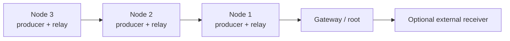

# MeshOps research prototype

MeshOps adds a single-root collection tree over ESP-NOW. Every `node` can
originate telemetry and relay telemetry received from descendant nodes. A
`gateway` is the root and exposes received event records over its local API.
One node plus one gateway is the minimum topology; additional nodes can relay
through one another up to the configured hop limit.

The current radio implementation is ESP-NOW. ESP-NOW uses the ESP32's Wi-Fi
radio, but nodes do not join a Wi-Fi network or create an access point to
participate in the mesh. All mesh devices must use the same configured radio
channel. The gateway can expose a separate management API over one optional
Wi-Fi access point; this is for configuration/status, not mesh forwarding.
The external receiver link in
the diagram is a future adapter point; LoRa transport is not implemented in
this prototype.

## Event model

The mesh packet schema accepts only the following integer-valued event kinds:

* `heartbeat`
* `synthetic_counter`
* `link_test`

Nodes currently generate `synthetic_counter` events at the configured
interval. The mesh transport does not accept arbitrary strings or file
contents. Existing DuckLogger HID and local logging code is left intact and
is not connected to the mesh publisher.

## Configure a bench topology

1. Copy `configs/gateway.example.json` to the gateway board as
   `settings.json`. Its `management` block enables the single optional AP
   used to reach the gateway API. Change its example password.
2. Copy `configs/node.example.json` to each node and give each node a unique
   `device.id`. Nodes have `management.enabled` set to `false`; they do not
   start a Wi-Fi AP or join an infrastructure network.
3. Set the same `mesh.network_id` and `mesh.channel` on all devices. Keep the
   channel fixed during a bench run. If `mesh.peer_key` is used, configure the
   same 16-byte key on every device.
4. Flash each board with the existing `python flasher.py` workflow.
5. Check the gateway's management AP for `GET /mesh/status` root status and
   received counts. The
   gateway records synthetic events at `GET /mesh/log` in NDJSON format.

For the minimum topology, use one node and one gateway. For relay validation,
place a second node where it can reach the first node but not the gateway.
Measure delivery, hop count, recovery after a node restart, and behavior when
the parent route expires. Keep test payloads synthetic.

Protocol version 2 adds application acknowledgements. Update every node and
the gateway in the same maintenance window before measuring; mixed protocol
versions do not provide end-to-end delivery confirmation.

## Current protocol behavior

* Gateways broadcast periodic root advertisements with hop count zero.
* Nodes select the advertised parent with the shortest path, subject to the
  configured gateway ID and maximum hop count.
* A node with local events sends them toward its selected parent. Received
  events are deduplicated by source ID and sequence number, then relayed with
  a decremented TTL.
* Nodes retain their own queued events while no route is available. The queue
  is bounded; oldest events are dropped when full. Optional `queue_persist`
  stores synthetic events and the sequence counter in a local flash outbox.
* The gateway sends an application ACK. Nodes retry missing ACKs up to
  `max_retries` times after the initial transmission, then record retry
  exhaustion and discard the event.
* Relays remember the reverse path for an event so its ACK can travel back to
  the source. Duplicate data is not logged twice at the gateway, but is
  forwarded again when needed to recover a lost ACK.
* Nodes rank fresh routes by hop count. After `route_failover_failures`
  consecutive delivery failures, a parent is held out for one route timeout;
  another fresh parent can take over. An ACK resets that parent's failure
  count.
* Routes expire after `route_timeout_ms` without an advertisement.

`/mesh/status` reports sends, receives, deliveries, retries, retry exhaustion,
route failovers, pending queue depth, route candidates, and average
queue-to-ACK time. This timing includes queueing and retries, so it is not a
one-way latency measurement. The gateway's NDJSON log records its local
monotonic receive time, synthetic event fields, hop count, and last-hop MAC.
Use `telemetry_batch` with `telemetry_interval_ms` to set repeatable synthetic
load levels. `queue_persist` is disabled by default because outbox updates write
to flash; enable it for reboot-recovery experiments.

ESP-NOW, Wi-Fi AP operation and the exact MicroPython build should be validated
on the target ESP32-S3 boards. Route scoring currently uses hop count and
application ACK failures, not RSSI/SNR. Device clocks are not synchronized, so
gateway receive timestamps cannot be directly compared with node timestamps.
Outbox persistence is best-effort. OTA and an external radio adapter are not
implemented.
