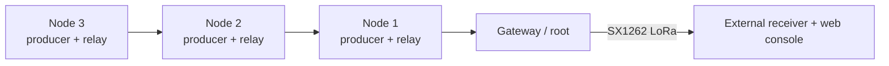

# MeshOps research prototype

MeshOps adds a multi-root collection mesh over ESP-NOW. Every `node` can
originate telemetry and relay telemetry received from descendant nodes. A
`gateway` is a root and exposes received event records over its local API.
One node plus one gateway is the minimum topology; additional nodes can relay
through one another up to the configured hop limit.

The current radio implementation is ESP-NOW. ESP-NOW uses the ESP32's Wi-Fi
radio, but nodes do not join a Wi-Fi network or create an access point to
participate in the mesh. All mesh devices must use the same configured radio
channel. The gateway can expose a separate management API over one optional
Wi-Fi access point; this is for configuration/status, not mesh forwarding.
The external uplink uses SX1262 radios. It is gateway egress, not a second mesh
transport: ESP-NOW still carries node and relay traffic.

`MeshNetwork` owns routing and delivery semantics through the `RadioTransport`
interface. `EspNowTransport` owns radio setup, encrypted peer registration,
send/receive operations, and transport status. The configured
`mesh.transport` value must currently be `espnow`.

## Event model

The mesh packet schema accepts only the following event kinds:

* `heartbeat`
* `synthetic_counter`
* `link_test`
* `key_event` (decoded DuckLogger press string, at most 120 characters)

Nodes generate `synthetic_counter` events at the configured interval when
`device.synthetic_telemetry` is true, or `key_event` events when
`device.data_source` is enabled. Set both to false for a relay-only node.
The mesh transport
does not accept arbitrary strings or file contents. Existing DuckLogger HID and
local logging code is left intact; `data_source` mode reads the UART and does
not initialize USB HID.

## Configure a bench topology

1. Copy `configs/gateway.example.json` to the gateway board as
   `settings.json`. Its `management` block enables the single optional AP
   used to reach the gateway API. Replace the example password, API token,
   peer key, and peer MACs before flashing; startup rejects placeholders.
2. Copy `configs/node.example.json` to each node and give each node a unique
   `device.id`. Nodes have `management.enabled` set to `false`; they do not
   start a Wi-Fi AP or join an infrastructure network. Set
   `device.data_source` to `true` for DuckLogger key events, or set both
   `data_source` and `synthetic_telemetry` to `false` for relay only.
3. Set the same `mesh.network_id`, `mesh.channel`, and 16-byte
   `mesh.peer_key` on all devices. Keep the channel fixed during a bench run.
   Fill `mesh.peer_macs` with every device that may send or relay traffic;
   packets from unknown MACs are dropped.
4. Flash each board with the existing `python flasher.py` workflow.
5. Check the gateway's management AP for `GET /mesh/status` root status and
   received counts. The
   gateway records events at `GET /mesh/log` in NDJSON format.

For the minimum topology, use one node and one gateway. For relay validation,
place a second node where it can reach the first node but not the gateway.
Measure delivery, hop count, recovery after a node restart, and behavior when
the parent route expires. Start with synthetic payloads, then enable
`data_source` on an isolated bench.

Protocol version 4 adds boot identity, targeted gateways, route load/epoch
fields, and gateway-aware acknowledgements. Update every node and gateway in the same
maintenance window before measuring; mixed protocol versions do not provide
end-to-end delivery confirmation.

## Current protocol behavior

* Gateways broadcast periodic root advertisements with hop count zero.
* Nodes keep candidates for configured gateways. `best` ranks hop count then
  load; `primary` ranks configured gateway order; `all` queues one targeted
  copy with the same event identity for each gateway.
* A node with local events sends them toward its selected parent. Received
  events are deduplicated by source ID and sequence number, then relayed with
  a decremented TTL.
* Nodes retain their own queued events while no route is available. The queue
  is bounded; oldest events are dropped when full. Optional `queue_persist`
  stores queued events and the sequence counter in a local flash outbox.
* The gateway sends an application ACK. Nodes retry missing ACKs up to
  `max_retries` times after the initial transmission, then record retry
  exhaustion and discard the event.
* Relays remember the reverse path for an event so its ACK can travel back to
  the source. Duplicate data is not logged twice at the gateway, but is
  forwarded again when needed to recover a lost ACK.
* Nodes rank fresh routes by hop count. After `route_failover_failures`
  consecutive delivery failures, a parent is held out for one route timeout;
  another fresh parent can take over. An ACK resets that parent's failure
  count.
* Routes expire after `route_timeout_ms` without an advertisement.
* Every received packet must come from a MAC listed in `mesh.peer_macs`;
  packets from unknown MACs are dropped before decoding or relaying.
  Listed peers are registered with the ESP-NOW LMK at startup so encrypted
  packets can be received before either side has transmitted directly.
* The gateway owns egress and forwards each stored record to one or more
  independent backends
  (`log`, `wifi`, `lora`, or `sendmy`). Egress is batched, bounded, persisted to a local spool,
  and retried with bounded exponential backoff. Send My buffers key events and
  emits one UART line per `sendmy.batch_interval_ms` (default 60000), capped by
  `sendmy.batch_size`; a single event uses v1 and multiple events use a compact
  v2 batch that preserves each source, boot ID, and sequence. The same timed
  batching applies to direct implant Send My. Wi-Fi
  egress requires `management.enabled: true`; use `management.mode: "sta"` to
  reach a collector outside the gateway AP, or keep AP mode and place the
  collector on that AP.
  The deployed gateway defaults to LoRa; Wi-Fi egress is selected only by a
  manual operator configuration.
* `lora_sink` is exclusively a destination of the gateway's `lora` backend;
  it does not expose or execute an egress configuration.

## SX1262 uplink protocol and receiver

Both reference LoRa endpoints use the Seeed 113110064 XIAO ESP32S3 +
Wio-SX1262 B2B kit. The GPIO mapping is SCK 7, MISO 8, MOSI 9, NSS 41,
RESET 42, BUSY 40, DIO1 39, and RF_SW 38. `RF_SW` is high for receive and low
for transmit. The radio initialization enables the module's DIO3-controlled
1.8 V TCXO and calibrates the image for the configured 868 or 915 MHz band.
Do not reuse these values for the pin-header Wio-SX1262 variants.

`lora_frame.py` uses a compact binary header containing magic, protocol
version, type, session, message sequence, fragment index/count, and payload
length. Every frame has a truncated 96-bit HMAC-SHA256 tag using `lora.key`.
Messages are split below the SX1262 packet limit. The receiver returns a bitmap
ACK after every valid data fragment. The half-duplex gateway waits for that ACK
before sending the next fragment and retransmits only the missing fragment up
to `lora.max_retries`.

The `lora_sink` role reassembles a JSON batch and accepts only
`heartbeat`, `synthetic_counter`, `link_test`, and `key_event`. It deduplicates
batches by `(session, message_seq)` and events by `(session, source, sequence)`.
It enriches events with local implant labels, marks `hop_count <= 1` as direct
and larger values as relay, and appends NDJSON into bounded rotating files.
Its authenticated API exposes status, live events, bounded reconstructed text
streams per implant/session, topology, implants, sessions, and log
download/deletion. RSSI/SNR describe the gateway-to-receiver
LoRa link, not the ESP-NOW implant link.

`/mesh/status` reports the active transport and its channel/MAC/peer count,
sends, receives, deliveries, retries, retry exhaustion,
route failovers, pending queue depth, route candidates, egress backend/spool
state and retry counters, and average
queue-to-ACK time. This timing includes queueing and retries, so it is not a
one-way latency measurement. The gateway's NDJSON log records its local
monotonic receive time, event fields, hop count, and last-hop MAC.
Use `telemetry_batch` with `telemetry_interval_ms` to set repeatable synthetic
load levels. `queue_persist` is disabled by default because outbox updates write
to flash; enable it for reboot-recovery experiments.

ESP-NOW, Wi-Fi AP operation and the exact MicroPython build should be validated
on the target ESP32-S3 boards. Route scoring currently uses hop count and
application ACK failures, not RSSI/SNR. Device clocks are not synchronized, so
gateway receive timestamps cannot be directly compared with node timestamps.
Outbox persistence and LoRa in-flight state are best-effort. OTA is not
implemented. Multi-gateway copies are deduplicated downstream using network,
implant, boot ID, and sequence. Message authentication, replay protection, and per-device keys are
not implemented; `mesh.peer_macs` is a filtering allowlist, not a
cryptographic identity.
