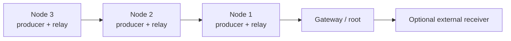

# MeshOps research prototype

MeshOps adds a single-root collection tree over ESP-NOW. Every `node` can
originate telemetry and relay telemetry received from descendant nodes. A
`gateway` is the root and exposes received event records over its local API.
One node plus one gateway is the minimum topology; additional nodes can relay
through one another up to the configured hop limit.

The current radio implementation is ESP-NOW. The external receiver link in
the diagram is a future adapter point; LoRa transport is not implemented in
this prototype.

## Event model

The mesh packet schema accepts only the following integer-valued event kinds:

* `heartbeat`
* `synthetic_counter`
* `link_test`

Nodes currently generate `synthetic_counter` events at the configured
interval. The mesh transport does not accept arbitrary strings or file
contents. Existing DuckLogger HID and local logging code is left intact and
is not connected to the mesh publisher.

## Configure a bench topology

1. Copy `configs/gateway.example.json` to the gateway board as
   `settings.json`.
2. Copy `configs/node.example.json` to each node and give each node a unique
   `device.id`.
3. Set the same `mesh.network_id` and `mesh.channel` on all devices. Keep the
   channel fixed during a bench run. If `mesh.peer_key` is used, configure the
   same 16-byte key on every device.
4. Flash each board with the existing `python flasher.py` workflow.
5. Check gateway `GET /mesh/status` for root status and received counts. The
   gateway records synthetic events at `GET /mesh/log` in NDJSON format.

For the minimum topology, use one node and one gateway. For relay validation,
place a second node where it can reach the first node but not the gateway.
Measure delivery, hop count, recovery after a node restart, and behavior when
the parent route expires. Keep test payloads synthetic.

## Current protocol behavior

* Gateways broadcast periodic root advertisements with hop count zero.
* Nodes select the advertised parent with the shortest path, subject to the
  configured gateway ID and maximum hop count.
* A node with local events sends them toward its selected parent. Received
  events are deduplicated by source ID and sequence number, then relayed with
  a decremented TTL.
* Nodes retain their own queued events while no route is available. The queue
  is bounded; oldest events are dropped when full.
* Routes expire after `route_timeout_ms` without an advertisement.

ESP-NOW, Wi-Fi AP operation and the exact MicroPython build should be validated
on the target ESP32-S3 boards. The prototype does not yet implement persistent
queue recovery, link-quality scoring, acknowledgements/retries, OTA, or the
gateway's external radio adapter.
