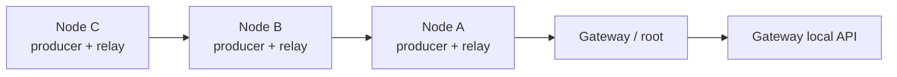

# DuckLogger MeshOps

> Research prototype for authorized engagements and isolated lab testing. Use
> only on equipment and networks for which you have explicit authorization.

This repository documents the **MeshOps adaptation** of DuckLogger: a local,
multi-hop telemetry mesh intended to evaluate whether nodes can exchange data
through one another without requiring a separately managed Wi-Fi access point
at every node location.

For the original DuckLogger project, its hardware, core features, and original
setup instructions, see the [upstream DuckLogger README](https://github.com/Itsmmdoha/duckLogger#readme).
This README covers only the MeshOps changes and setup.

## Mesh topology

The minimum topology is **one node (implant) and one gateway**. Each node can
produce synthetic telemetry and relay telemetry from other nodes. Add nodes to
extend the multi-hop collection tree; the gateway is the root and stores
received events.

The mesh uses **ESP-NOW**. It uses the ESP32 Wi-Fi radio, but nodes do not join
a Wi-Fi network or create their own access point to participate. The gateway
can optionally enable one management access point for its local API; that
access point is not the mesh transport. All devices must use the same mesh
channel.

## Adaptations in this repository

- Versioned telemetry packets with an event allowlist, deduplication, and
  time-to-live handling.
- Gateway route advertisements; nodes select a parent route subject to the
  configured hop limit and route expiry.
- Synthetic node telemetry and multi-hop forwarding with a bounded queue.
- Gateway-side NDJSON event storage and `/mesh/status` and `/mesh/log` API
  endpoints.
- Separate example configurations for nodes and the gateway.

Only `heartbeat`, `synthetic_counter`, and `link_test` events with integer
values are currently accepted. The mesh path is for synthetic operational
telemetry; it does not transport keyboard logs or arbitrary file contents.

## Bench setup

1. Use an ESP32-S3 board with a MicroPython build that supports ESP-NOW. Flash
   MicroPython using the
   [ESP32_GENERIC_S3 instructions](https://micropython.org/download/ESP32_GENERIC_S3/).
2. Clone this repository and install it on each board using `python flasher.py`.
3. Copy `configs/gateway.example.json` to the gateway as `/settings.json`.
   This enables one optional management AP for the local API. Change the
   example password before use outside an isolated bench.
4. Copy `configs/node.example.json` to every node as `/settings.json` and set a
   unique `device.id` on each. Nodes have management Wi-Fi disabled by default.
5. Set the same `mesh.network_id` and `mesh.channel` on all devices. If using
   `mesh.peer_key`, configure the same 16-byte key on each device.
6. Begin with one node and one gateway. To exercise relaying, add a second
   node that can reach the first but not the gateway. Use only synthetic data.
7. Query `/mesh/status` and `/mesh/log` through the gateway's local API.

See [`MESHOPS.md`](MESHOPS.md) for protocol behavior, configuration details,
and current limitations.

## Scope and limitations

This is a research prototype, not a production-ready transport. ESP-NOW and
Wi-Fi management AP coexistence must be validated on the target board and
MicroPython build. Persistent queue recovery, link-quality scoring,
acknowledgements/retries, OTA, and an external radio adapter such as LoRa are
not implemented. The original DuckLogger core is retained separately; this
repository's MeshOps changes do not connect that core's HID/logging data to
the mesh.
