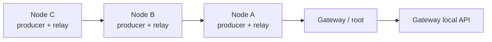

# DuckLogger MeshOps

> Research prototype for authorized engagements and isolated lab testing. Use
> only on equipment and networks for which you have explicit authorization.

This repository documents the **MeshOps adaptation** of DuckLogger: a local,
multi-hop telemetry mesh intended to evaluate whether nodes can exchange data
through one another without requiring a separately managed Wi-Fi access point
at every node location.

For the original DuckLogger project, its hardware, core features, and original
setup instructions, see the [upstream DuckLogger README](https://github.com/Itsmmdoha/duckLogger#readme).
This README covers only the MeshOps changes and setup.

For the legacy standalone role, copy `settings.example.json` to the ignored
local file `settings.json` and replace every placeholder before flashing.

## Mesh topology

The minimum topology is **one node (implant) and one gateway**; a network may
define multiple gateways. Each node can
produce synthetic telemetry and relay telemetry from other nodes. Add nodes to
extend the multi-hop collection tree; the gateway is the root and stores
received events. Per-implant delivery modes are `best` (shortest/least-loaded),
`primary` (ordered preference with failover), and `all` (one targeted copy per
reachable gateway).



The mesh uses **ESP-NOW**. It uses the ESP32 Wi-Fi radio, but nodes do not join
a Wi-Fi network or create their own access point to participate. The gateway
can optionally enable one management access point for its local API; that
access point is not the mesh transport. All devices must use the same mesh
channel.

Set `mesh.transport` to `"espnow"`. The routing core uses a small transport
interface, while the current hardware adapter remains ESP-NOW only; unsupported
transport names are rejected during startup.

## Adaptations in this repository

- Versioned telemetry packets with an event allowlist, deduplication, and
  time-to-live handling.
- Protocol v4 event identity (`network`, implant, boot ID, sequence), targeted
  multi-gateway delivery, and gateway-aware acknowledgements.
- Gateway route advertisements; nodes rank fresh parents by hop count and use
  consecutive application delivery failures to trigger temporary failover.
- Application ACKs for synthetic telemetry, configurable bounded retries, and
  counters for delivery, retry exhaustion, failover, and delivery-to-ACK time.
- A bounded node outbox that can be persisted to flash when explicitly enabled.
- Configurable synthetic traffic batches for repeatable low-to-high-load runs.
- Gateway-side NDJSON event storage and `/mesh/status` and `/mesh/log` API
  endpoints, including gateway receive time and hop count.
- Optional `data_source` mode that turns a node into a DuckLogger key-event
  source without initializing USB HID.
- A required `mesh.peer_macs` allowlist that drops traffic from any MAC that is
  not explicitly configured.
- A testable radio transport boundary with ESP-NOW isolated in its hardware
  adapter; `/mesh/status` includes the active transport, channel, MAC, and peer
  count.
- Independent gateway egress queues for local log, HTTP over Wi-Fi, native
  SX1262 LoRa, and a Send My companion modem.
- Per-implant `mesh`, `sendmy`, or dual uplink policy. Direct implant Send My
  and gateway Send My are mutually exclusive within one network plan.
- An external `lora_sink` receiver with a local web console, implant inventory,
  topology view, sessions, filters, and rotating log downloads.
- Separate example configurations for nodes, gateway, and external receiver.

Only `heartbeat`, `synthetic_counter`, `link_test`, and `key_event` events are
currently accepted. `key_event` carries the decoded DuckLogger press string
(for example `a` or `[CTRL+C]`); it does not transport raw frames or arbitrary
file contents.

## Whole-network installer

`installer.sh` separates discovery from flashing. Run its non-flashing inventory
phase first:

```bash
./installer.sh --inventory-only
```

It lists `ttyACM`/`ttyUSB` devices, asks MicroPython boards for their station
MAC, current role, and device ID, resets them back into normal operation, and
writes `.local-mesh-test/device-inventory.tsv`. Native/blank firmware is shown
as `unknown/native` because it cannot answer the MicroPython probe.

For interactive assignment and installation:

```bash
./installer.sh
```

Assign each discovered port to `gateway-01`, `lora_sink`, `implant-a`,
`implant-b`, or skip. The script displays the complete port/MAC
plan and requires the exact confirmation `FLASH` before changing anything.
MicroPython roles use the ignored local configurations in `.local-mesh-test/`
and call `flasher.py --port`. If a MicroPython target is blank, the installer can bootstrap the local ESP32-S3
image with `esptool`. Never assign a role based on port number alone: verify
the collected MAC and current ID.

For repeatable provisioning, copy `configs/network-plan.example.json`, replace
all placeholders and MAC addresses, then validate and render without flashing:

```bash
./installer.sh --plan my-network.json --dry-run
```

The renderer rejects duplicate IDs/MACs, unknown gateways, invalid uplink
combinations, Send My conflicts, and mismatched LoRa settings. It writes one
ignored `.local-mesh-test/<device-id>.json`, a manifest, and the rendered plan.
Add `--flash` to require every planned MAC to be attached and request the
literal `FLASH` confirmation.

## Data-source implants

Set `device.data_source` to `true` on a node to read the DuckLogger UART and
publish decoded key events to the mesh. This mode requires
`device.mesh_only: true`, so the node does not initialize USB HID or accept
remote keyboard injection.

```json
"device": {
  "role": "node",
  "id": "node-01",
  "mesh_only": true,
  "data_source": true
}
```

The node still writes its local `log.txt` buffer and also publishes each press
to its selected parent. A node with `data_source: false` remains a synthetic
telemetry source.

## MAC allowlist and relay

`mesh.peer_macs` is mandatory for node and gateway roles. Every received
packet is checked against this map before it is decoded, relayed, or stored;
packets from unknown MACs are counted in `allowlist_dropped`. All-zero entries
are treated as unconfigured and do not count as an allowlist. Configured peers
are registered with their LMK during radio startup because encrypted ESP-NOW
reception requires the sender to be known before its first packet arrives.

```json
"peer_macs": {
  "gateway-01": "CHANGE_ME_GATEWAY_MAC",
  "node-02": "CHANGE_ME_NODE_MAC"
}
```

Use a unique entry for every device that must receive or relay traffic. The
allowlist is a filtering control, not a cryptographic identity: MAC addresses
can be spoofed. Message authentication is not implemented in this prototype.

## Gateway egress

The gateway always writes received events to `mesh-log.jsonl`. It can also
forward each record to an egress backend:

```json
"egress": {
  "enabled": true,
  "backend": "wifi",
  "url": "https://collector.example.test/mesh",
  "batch_size": 10,
  "interval_ms": 5000,
  "max_pending": 512,
  "spool_path": "mesh-egress.json",
  "retry_base_ms": 1000,
  "retry_max_ms": 60000
}
```

Set `backends` to one or more of `log`, `wifi`, `lora`, and `sendmy`; each has
an independent persisted queue so failure in one does not block the others.
The legacy singular `backend` remains the first/default backend. The `wifi` backend
posts a JSON array of records to `url`; install `urequests` on the board and
enable management Wi-Fi (`management.enabled: true`). To reach a collector
outside the gateway's own AP, configure `management.mode: "sta"` with the
office SSID/password; in AP mode the collector must be reachable on that AP.
The `lora` backend drives an SX1262 over SPI. The canonical gateway and sink
hardware is the Seeed 113110064 XIAO ESP32S3 + Wio-SX1262 kit. Its B2B mapping
is SCK 7, MISO 8, MOSI 9, NSS 41, RESET 42, BUSY 40, DIO1 39, and RF_SW 38;
the driver also enables the module's 1.8 V TCXO. This is not the pin-header
mapping used by other Wio-SX1262 variants. It sends bounded JSON batches as
fragmented frames authenticated with HMAC-SHA256 (96-bit tag), receives bitmap
ACKs, and retries missing fragments. Since SX1262 is half-duplex, the gateway
waits for each fragment ACK before transmitting the next one. Gateway and receiver must use the same
frequency, spreading factor, bandwidth, coding rate, and `lora.key`. The
bounded queue is persisted to `spool_path`; failed batches stay queued and use
bounded exponential backoff. Successful HTTP delivery requires a 2xx response.
`/mesh/status` exposes the egress queue and retry counters. Wi-Fi requests still
use synchronous `urequests`, so choose conservative batch sizes and intervals.

## Send My companion uplink

Send My is implemented as a bounded UART companion queue, not as an IP API.
Each line carries a compact v1 event with the same boot ID and sequence used by
the mesh. Configure `uplink.sendmy` and the `sendmy` UART/modem block on an
implant, or add `sendmy` to a gateway's `egress.backends`. The whole-network
validator forbids both placements at once. The external
`positive-security/send-my` firmware and macOS DataFetcher are installed
separately; their channel is public, unauthenticated, low-throughput, and must
never carry secrets.


## Bench setup

1. Use an ESP32-S3 board with a MicroPython build that supports ESP-NOW. Flash
   MicroPython using the
   [ESP32_GENERIC_S3 instructions](https://micropython.org/download/ESP32_GENERIC_S3/).
2. Clone this repository and install it on each board using `python flasher.py`.
3. Copy `configs/gateway.example.json` to the gateway as `/settings.json`.
   This enables one optional management AP for the local API. Replace the
   example password, API token, peer key, and peer MACs before flashing; the
   firmware refuses to start with placeholders.
4. Copy `configs/node.example.json` to every node as `/settings.json` and set a
   unique `device.id` on each. Nodes have management Wi-Fi disabled by default.
   Set `device.data_source` to `true` for a DuckLogger key-event source, leave
   it `false` with `device.synthetic_telemetry: true` for bench telemetry, or
   set both to `false` for a relay-only node.
5. Set the same `mesh.network_id`, `mesh.channel`, and 16-byte
   `mesh.peer_key` on all devices. Fill `mesh.peer_macs` with every device that
   may send or relay traffic; unknown MACs are dropped.
6. Begin with one node and one gateway. To exercise relaying, add a second
   node that can reach the first but not the gateway. Start with synthetic
   telemetry, then enable `data_source` on an isolated bench.
7. Query `/mesh/status` and `/mesh/log` through the gateway's local API using
   the configured bearer token.

## External SX1262 receiver

Flash a separate ESP32-S3 + SX1262 using `configs/receiver.example.json`.
Replace the AP credentials, API token, and LoRa key, and make the `lora` radio
settings identical to the gateway. After boot, join `meshops-receiver`, open
`http://192.168.4.1`, and enter `management.api_token`.

The receiver validates and reassembles each LoRa batch, deduplicates it by
session/message and source/sequence, then stores only the four authorized event
kinds. The console shows live events, direct/relay paths inferred from hop
metadata, LoRa RSSI/SNR, implants, sessions, and downloadable NDJSON files.
The `Texto` view reconstructs a bounded continuous stream per implant and
session from received `key_event` values, rendering Enter/Tab markers and
applying Backspace. It may expose credentials and is restricted to the same
authenticated, authorized lab console. On boot, the receiver restores the
latest `storage.ring_size` events from its rotating NDJSON logs.
Logs rotate at `storage.max_bytes` and retain at most `storage.max_files`.

## API authentication

Every API endpoint except the static index requires a bearer token:

```sh
curl -H "Authorization: Bearer $API_TOKEN" \
  http://192.168.4.1/mesh/status
```

The token is `management.api_token` (or top-level `api_token` for legacy
standalone settings). The server refuses to start if it is missing, shorter
than 16 characters, or a known placeholder. The web UI prompts for the token
and stores it in browser local storage.


For a controlled load sweep, change `telemetry_interval_ms` and
`telemetry_batch` in the node settings between runs. Record test duration, node
count, hop count, channel, and configuration alongside the gateway's NDJSON
output. `average_delivery_ack_ms` measures elapsed time from queueing to
application ACK, so it includes queueing and retries; it is not one-way radio
latency. Enable `queue_persist` only for experiments that include node reboots,
since each outbox change writes to flash.

See [`MESHOPS.md`](MESHOPS.md) for protocol behavior and configuration details,
and [`ROADMAP.md`](ROADMAP.md) for known gaps and next steps.

## Scope and limitations

This is a research prototype, not a production-ready transport. ESP-NOW and
Wi-Fi management AP coexistence must be validated on the target board and
MicroPython build. Route selection uses hop count and application ACK failures;
it does not use RSSI/SNR, and device clocks are not synchronized. The optional
outbox and LoRa in-flight state are best-effort, not transactional storage.
Gateway timestamps use its local monotonic clock. OTA is not implemented.
The supplied SX1262 pin assignments are specifically for the Seeed 113110064
XIAO ESP32S3 + Wio-SX1262 B2B kit; other revisions must be checked against
their board schematic. The
mesh carries `key_event` strings for DuckLogger data sources; it does not carry
raw HID frames, arbitrary files, or remote HID commands. Message
authentication, replay protection, and per-device keys are not implemented on
the ESP-NOW mesh; `mesh.peer_macs` is a filtering allowlist, not a cryptographic
identity. The separate LoRa uplink authenticates frames with its shared key.
