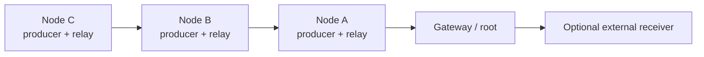

# DuckLogger MeshOps

> **Research prototype for authorized red-team engagements and lab testing.**
> Use only on equipment and networks for which you have explicit authorization.
> MeshOps telemetry is synthetic; this prototype does not send keyboard logs
> or file contents through the mesh.

DuckLogger MeshOps is a research adaptation of the existing DuckLogger
ESP32-S3 project. The original DuckLogger core is retained; this repository
adds an experimental local mesh so a deployment can be studied without
requiring a separately managed Wi-Fi access point at every device location.
It is intended to help evaluate coverage, multi-hop forwarding, and recovery
in an authorized office engagement. It is not a production-ready or covert
communications system.

## MeshOps architecture

The minimum topology is **one node (implant) and one gateway**. A node
originates synthetic telemetry and can also relay telemetry from other nodes.
Add nodes to extend the local multi-hop collection tree; the gateway is the
root and exposes received events through its local API.



The current mesh transport is **ESP-NOW**. The optional external receiver
shown above is an extension point: a LoRa or other external radio link is not
implemented. This prototype also does not remove the need to plan or validate
radio coverage; test the actual office environment and target hardware before
drawing conclusions.

### What was added

- A versioned, compact telemetry protocol with event validation,
  deduplication, and time-to-live handling.
- Gateway root advertisements and node route selection with a configurable
  hop limit and route expiry.
- Node event generation and multi-hop forwarding using synthetic counters;
  queues are bounded when a route is unavailable.
- Gateway storage of received events in NDJSON and local `/mesh/status` and
  `/mesh/log` endpoints.
- Example node/gateway configurations and this setup guide.

The event allowlist currently contains `heartbeat`, `synthetic_counter`, and
`link_test`, with integer values. The mesh does not accept arbitrary file
contents. The original HID and local logging components remain part of the
upstream-derived core and are kept separate from the MeshOps telemetry path.

For protocol behavior, configuration fields, and known limitations, see
[`MESHOPS.md`](MESHOPS.md).


The upstream DuckLogger core is an ESP32-S3 USB HID and local logging project.
MeshOps is an experimental extension; it does not change the core's purpose or
make its HID/logging features part of the mesh.
Recreating this project doesn't require any custom PCB. Hardware used here is less than $10 in total on places like Aliexpress.


## Features

* **Keystroke Logging**: Records keystrokes and saves them to a log file in the internal flash storage.
* **Dual Wi-Fi Modes**: Supports both Wi-Fi Station mode (connect to an existing network) and Access Point (Hotspot) mode.
* **Web Command & Control Center**: Access a built-in web interface to manage your device. The control center allows you to:
  * **Download Logs**: Easily download the saved keystroke log file.
  * **Remote Live Keyboard**: Attach a live virtual keyboard and send keystrokes via WebSocket in real-time with almost no latency.
  * **DuckyScript Injection**: Inject and execute DuckyScript payloads remotely.
  * **Device Settings**: Update configurations for AP/Station mode directly from the web UI.

Access the web UI at:
```
http://192.168.4.1/
```
*(When in Access Point mode)*


## Components Used

* ESP32-S3 SuperMini
* CH9350 HID Module
* 4 Female Jumper Wires

---

# Getting Started

## 1. Schematics


| ESP32-S3 | CH9350 |
| -------- | ------ |
| 5V       | 5V     |
| GND      | GND    |
| GP1      | TX     |
| GP2      | RX     |

The CH9350 supports multiple operating modes, which are configured using the onboard DIP switches.


Set `S0` to the GND position (0) and keep all other switches in the opposite position (1). This enables USB Host Mode, which converts USB keyboard inputs into serial data sent via UART at a default baud rate of 115200.

## 2. Flash MicroPython

DuckLogger is written in MicroPython. Flash your board with MicroPython firmware.
Find flashing instructions [here](https://micropython.org/download/ESP32_GENERIC_S3/).

After flashing, disconnect and reconnect the board via USB.

## 3. Clone the Repository

```bash
git clone https://github.com/JoseAbreu28/DuckLogger-MeshOps.git
cd DuckLogger-MeshOps
```

MeshOps is currently developed on `codex/meshops-core`. Until that work is
merged, check it out with `git switch codex/meshops-core` before following the
MeshOps setup below.

## 4. Install DuckLogger on the Board

Make sure your board is connected via USB, then run:

```bash
python flasher.py
```

The flasher will automatically:

* Install `mpremote` and required MicroPython packages on the board
* Compress `index.html` and copy all files to the board
* Reboot the board

---

# Original DuckLogger core

The upstream core and its existing features remain in the repository. The
sections below describe that inherited project; MeshOps telemetry is a
separate, synthetic-only path. For authorized research, avoid collecting or
transmitting real user input and use isolated test equipment.

## MeshOps bench setup

1. Flash a supported ESP32-S3 board with a compatible MicroPython build and
   install the project using the existing `python flasher.py` workflow above.
2. Copy `configs/gateway.example.json` to the gateway board as
   `/settings.json`.
3. Copy `configs/node.example.json` to every node as `/settings.json`. Give
   each node a unique `device.id`.
4. Configure the same `mesh.network_id` and `mesh.channel` on every device.
   If using `mesh.peer_key`, set the same 16-byte key on all of them. Change
   example AP credentials before connecting outside an isolated bench.
5. Start with one node and one gateway. For a relay test, add a second node
   positioned so it can reach the first node but not the gateway. Use only
   synthetic events.
6. On the gateway, inspect `GET /mesh/status` and `GET /mesh/log` to observe
   mesh state and received NDJSON events.

ESP-NOW behavior, Wi-Fi AP coexistence/channel constraints, and the exact
MicroPython build still require validation on the target ESP32-S3 hardware.
The prototype has no persistent queue recovery, link-quality scoring,
acknowledgements/retries, OTA, or external radio adapter. Do not treat the
prototype as a dependable transport or as a substitute for an engagement's
approved rules of engagement.

# Usage

1. Plug the USB keyboard into the CH9350 HID module.
2. Connect the ESP32-S3 SuperMini to the target PC using a USB-C to USB-A cable.
3. The device will automatically:

   * Start logging keystrokes
   * Connect to Wi-Fi or create a Wi-Fi Access Point depending on your settings
   * Start an HTTP server

If in Access Point mode(Default), connect to the Wi-Fi Access Point (Default Password: `duckPass1234`) and open:

```
http://192.168.4.1/
```

To access the command and control center.


## Supported DuckyScript Syntax

DuckLogger currently supports a core set of DuckyScript commands for payload injection:

| Command | Description | Example |
| :--- | :--- | :--- |
| `DELAY` | Pauses execution for a specified number of milliseconds. | `DELAY 500` |
| `STRING` | Types out a sequence of characters exactly as written. | `STRING Hello, World!` |
| **Key Combos** | Sends simultaneous keystrokes. | `CTRL SHIFT ESC` or `ALT i` |
| **Single Keys** | Sends individual special keys. | `ENTER` or `TAB` |


# Repository Structure

```
.
├── flasher.py
├── index.html
├── configs
│   ├── gateway.example.json
│   └── node.example.json
├── lib
│   ├── access_point.py
│   ├── api.py
│   ├── mesh_network.py
│   ├── mesh_protocol.py
│   ├── mesh_store.py
│   ├── duckyscript.py
│   ├── keyboard.py
│   ├── key_led.py
│   ├── logger.py
│   ├── mapper.py
│   ├── microdot
│   │   ├── helpers.py
│   │   ├── __init__.py
│   │   ├── microdot.py
│   │   └── websocket.py
│   ├── queue.py
│   ├── settings.py
│   ├── uart_buffer.py
│   ├── wifi.py
│   └── wifi_radio.py
├── LICENSE
├── main.py
├── MESHOPS.md
├── README.md
├── resources.md
└── settings.json
```

## Third-Party Libraries

This project includes Microdot by Miguel Grinberg (MIT License):  
https://github.com/miguelgrinberg/microdot

---
