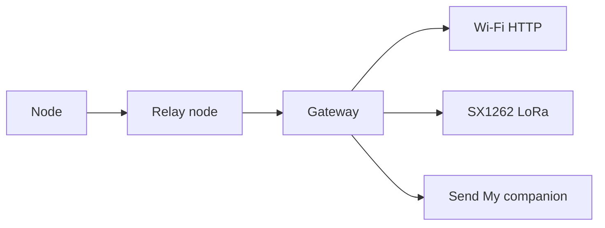

# DuckLogger MeshOps

> Research prototype for authorized engagements and isolated lab testing. Use
> only on equipment and networks for which you have explicit authorization.

DuckLogger MeshOps adds a local, multi-hop ESP-NOW telemetry network to
DuckLogger. Nodes can originate or relay authorized events. Gateways receive
and store events, then optionally forward them through a configured egress.

This repository documents the MeshOps layer. For the original DuckLogger
hardware and application, see the [upstream DuckLogger project](https://github.com/Itsmmdoha/duckLogger#readme).

## What is included

- ESP-NOW mesh networking with allowlisted peers, relay support, deduplication,
  acknowledgements, bounded retries, and route failover.
- Node, gateway, and external `lora_sink` roles.
- Gateway storage and authenticated `/mesh/status`, `/mesh/log`, and
  configuration endpoints.
- Gateway egress through local log, Wi-Fi HTTP, SX1262 LoRa, or a Send My
  companion modem.
- A whole-network installer that inventories boards, validates a network plan,
  renders per-device settings, and flashes exact serial ports.
- Hardware-free tests for protocol, settings, routing, storage, egress, and
  network-plan validation.

The accepted event kinds are `heartbeat`, `synthetic_counter`, `link_test`, and
`key_event`. A `key_event` is a decoded DuckLogger press string, limited to 120
characters. Raw HID frames, arbitrary files, and arbitrary payloads are not
transported.

## Network model



Nodes use ESP-NOW on the configured mesh channel; they do not join an ordinary
Wi-Fi network for mesh traffic. A gateway may separately expose a management
AP or station connection. LoRa is a gateway egress path, not the mesh radio.

`key_event` records can be published over the mesh when the node's
`uplink.mesh` policy is enabled. Use `mesh_only: true` for a node that should
publish data without initializing USB HID.

## Quick start

1. Copy an example plan and replace every `CHANGE_ME_*` value:

   ```bash
   cp configs/network-plan.example.json my-network.json
   ./installer.sh --plan my-network.json --dry-run
   ```

2. Inventory attached boards before assigning roles:

   ```bash
   ./installer.sh --inventory-only
   ```

3. Run the interactive installer. It shows the discovered port and MAC for
   each board and requires the exact confirmation `FLASH` before flashing:

   ```bash
   ./installer.sh
   ```

4. For a standalone device configuration, copy `settings.example.json` to the
   ignored local `settings.json`, replace all placeholders, and flash with:

   ```bash
   python flasher.py --port /dev/ttyACM0 --settings settings.json
   ```

The installer and settings validator reject placeholder secrets, incomplete
peer allowlists, duplicate device identities, invalid uplinks, and mismatched
LoRa parameters. Never select a board by serial-port name alone; verify its
reported MAC and device ID.

## Egress options

The gateway always stores received events locally. Additional egress backends
are configured in the gateway plan:

- `wifi`: posts bounded JSON batches to an operator-controlled HTTPS endpoint.
- `lora`: sends authenticated, fragmented frames over SX1262 to a
  `lora_sink`, with acknowledgements and retries.
- `sendmy`: writes bounded event records to a UART companion queue.
- `log`: keeps the local gateway log as the only egress.

The network validator prevents direct implant Send My uplink and gateway Send
My egress from being enabled in the same plan. Egress queues are bounded and
persisted; failed delivery remains queued for retry until the configured limit
is reached.

Send My support is based on the separately maintained
[positive-security/send-my](https://github.com/positive-security/send-my)
project by Positive Security. Its firmware, Apple Find My transport research,
and macOS DataFetcher are not bundled here and must be installed separately.
That channel is public, unauthenticated, and low-throughput; never send
secrets through it.

## LoRa sink

The external `lora_sink` role runs on an ESP32-S3 with an SX1262 radio. It
provides an authenticated local web console with event filters, implant and
session views, inferred direct or relay paths, RSSI/SNR, and bounded rotating
NDJSON logs.

The canonical hardware is the Seeed 113110064 XIAO ESP32S3 with the Wio-SX1262
B2B kit. Gateway and receiver must use the same frequency, spreading factor,
bandwidth, coding rate, and LoRa key.

## Security and scope

All examples contain placeholders only. Configure a unique mesh peer key,
management token, API credentials, and LoRa key for every deployment. Peer MAC
allowlists filter unknown senders before decode or relay, but MAC addresses are
not cryptographic identities; use this prototype only in an authorized,
isolated environment.

Do not commit local `settings.json`, real credentials, device MAC inventories,
logs, backups, caches, or `AGENTS.md` files. These paths are ignored or excluded
from the published source tree.

## Validation

Run the hardware-free checks from the repository root:

```bash
python -m pytest -q
python -m compileall -q main.py lib flasher.py
bash -n installer.sh
```

The CI workflow runs the pytest suite and Python compilation checks. No
MicroPython board is required for these checks.
